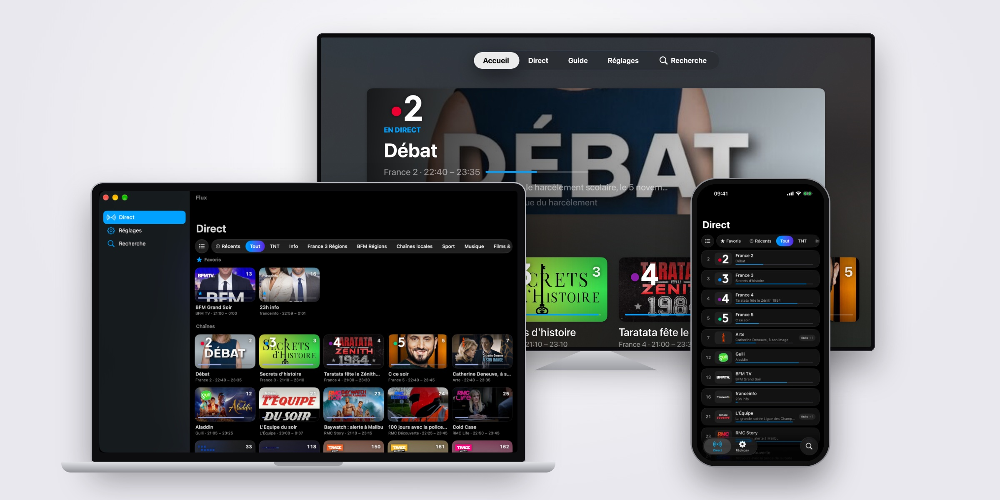
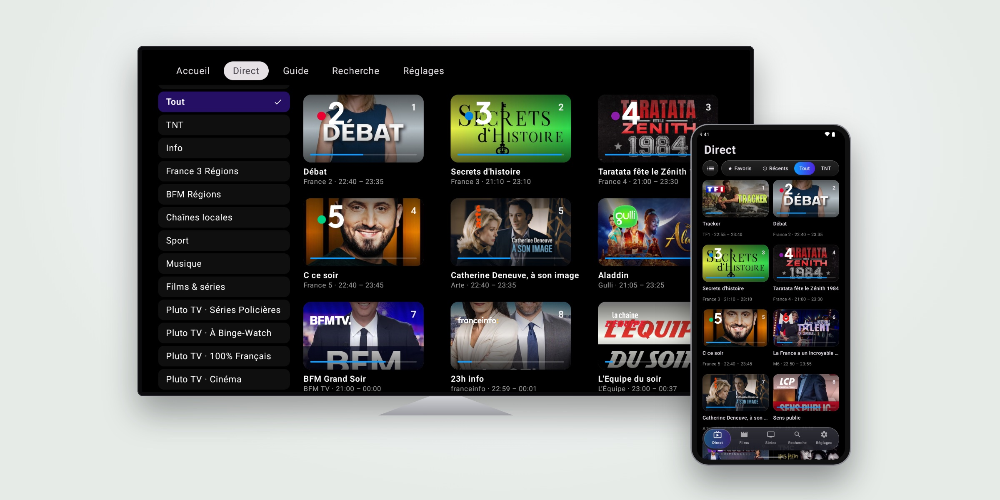

# Flux
Native IPTV player for Xtream Codes accounts (or their M3U link), made for the French market (for now): iPhone, iPad, Mac, Apple TV, Android and Android TV. Apple apps built 100% in Swift, Android apps in Kotlin.

## Features
- Local, no Flux account, no ads
- Liquid Glass
- Live TV, films and series from your Xtream Codes subscription
- Free French channels built in (France TV, Arte, BFM, RMC, L'Équipe, France 3 regions, Pluto TV…), read from the broadcasters' official streams, with your subscription as a fallback
- Channel numbering of your choice: provider, TNT, Orange, Bouygues, Free or SFR
- TV guide, with the open French TNT guide from [XML TV Fr](https://xmltvfr.fr)
- Time-shifted channels (« TF1 +4 ») grouped under their channel
- Default quality when a channel comes in several (SD, HD, 4K…)
- Favorites, resume where films and episodes stopped, recent channels
- Send an account from your phone to the TV over the local network, with its favorites and settings: no typing passwords with a remote

## Requirements
- iOS / iPadOS / tvOS 26+
- macOS 26+ (Apple Silicon or Intel, Mac Catalyst)
- Android 7+ (phone, tablet or Android TV / Google TV)
- An Xtream Codes IPTV subscription (Flux doesn't provide any content besides the free channels)

## Install
### iPhone, iPad, Mac, Apple TV
Join the TestFlight beta:
https://testflight.apple.com/join/Phqv7cn5

Or grab the .ipa (iPhone, iPad) from [Releases](https://github.com/tlfares/Flux/releases) and sideload it (AltStore, SideStore, Sideloadly…).

### Mac
Download the macOS .zip from [Releases](https://github.com/tlfares/Flux/releases), unzip it and move Flux to Applications. The app isn't notarized: on first launch, right-click → Open, or allow it in System Settings → Privacy & Security.

### Android / Android TV
Download the right .apk from [Releases](https://github.com/tlfares/Flux/releases):
- `Flux-x.x-Android.apk` for phones and tablets
- `Flux-x.x-AndroidTV.apk` for Android TV / Google TV

Then install it (allow installs from unknown sources). On a TV, use an app like Downloader or `adb install`.

You can also build everything from source: `Flux.xcodeproj` with Xcode, `FluxAndroid` with Android Studio.

## Disclaimer
Flux is only a player. It doesn't host, sell or provide any IPTV subscription or stream, except the free channels already published by their broadcasters. Use it with content you have the right to watch.
